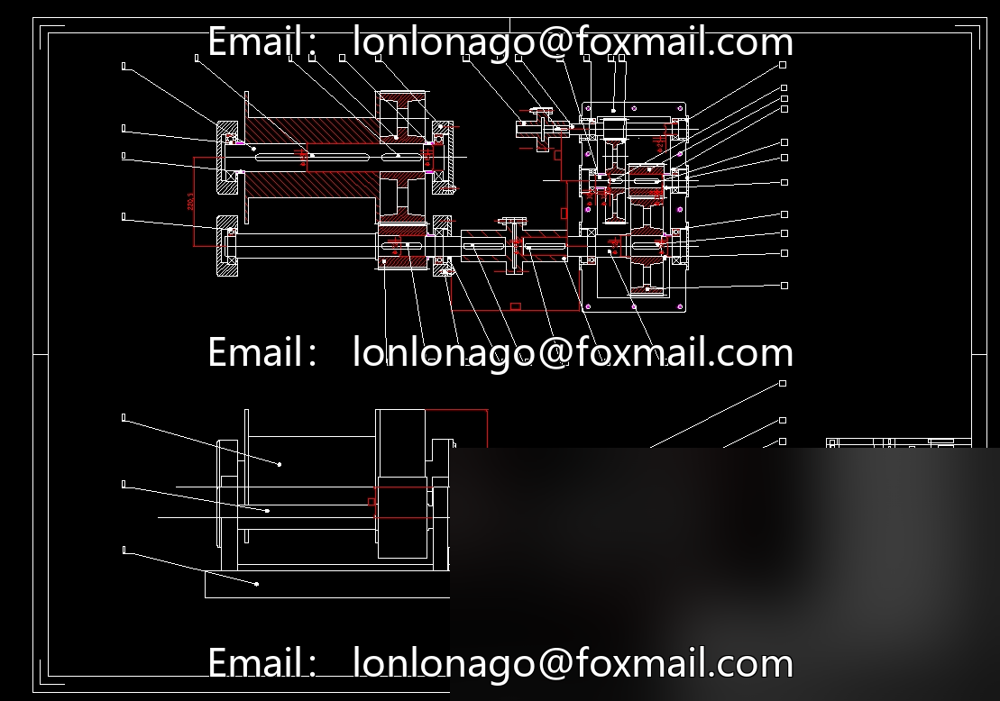
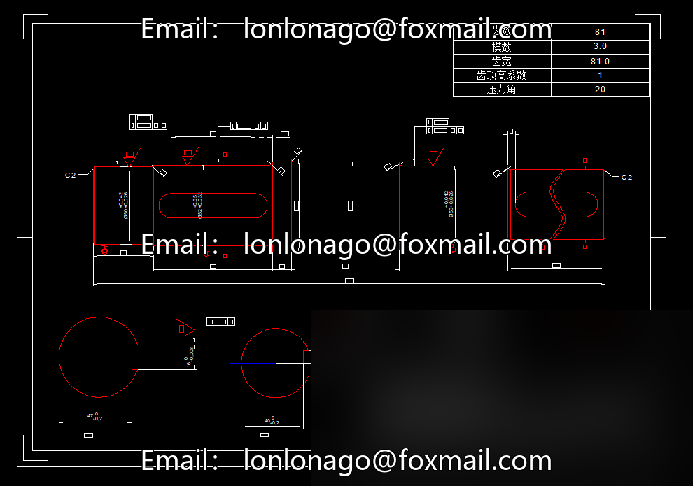
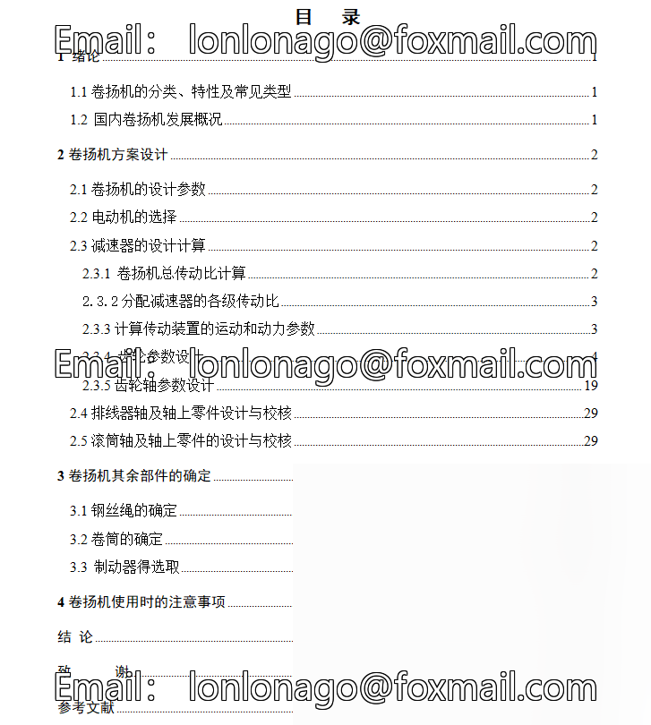

# Overhead hoist CAD design diagram

## Body

Canvaswiner CAD design drawing 494-Canvaswiner design Canvaswiner figure Canvaswiner design drawing Canvaswiner CAD drawing Canvaswiner design

The material includes CAD design diagrams and instructions, along with example files, assembly drawings, design parameters, gear parameters, cylinder and brake components and related content.

<!-- AI_ENRICHED -->

## Images

## Payment

Here is a pay link on Stripe ( https://buy.stripe.com/3cs8yP7sY87d0vu9AB ). Please contact me lonlonago@foxmail.com after funding $89, and I will send you a complete data files , thank you!

